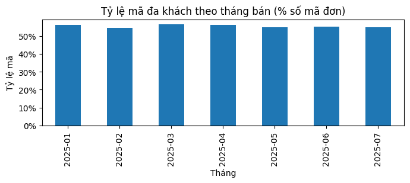
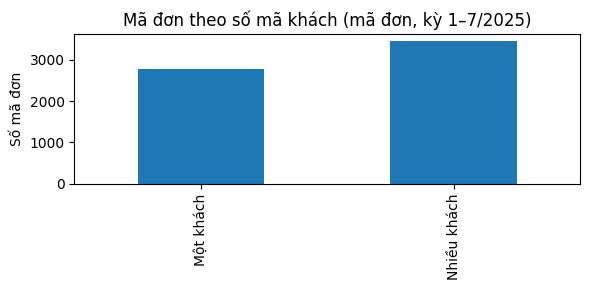
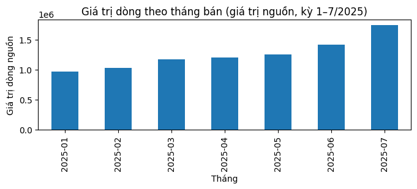
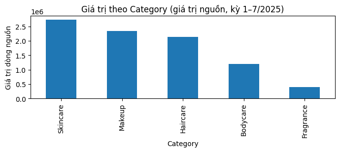

# Hiểu dữ liệu Nile Sales — bài đọc chính (Phase 1)

> Mọi số dưới đây tính mới từ `data/Nile_Sales_YTD.xlsx` trong
> `notebooks/01_understand_data.ipynb` (kernel sạch, exit 0).
> Nguồn file: subset thực hành lấy từ video Goodly
> (https://www.youtube.com/watch?v=1AavSLWhh-E&t=669s) — người dùng không truy được
> hệ thống. Cần tách ba lớp: (a) người dùng cho biết file để thực hành;
> (b) mô tả video xác nhận bộ thực hành, chưa xác nhận cách tạo hay giao dịch thật;
> (c) suy luận từ file. Không còn khẳng định đây là bản xuất trực tiếp từ hệ thống
> thật, cũng không cấm xét giả thuyết dữ liệu tạo/điều chỉnh.
> Nguồn hiện tại được chấp nhận cho run mới
> (SHA `fae7a695…6d4fc0bd8`): 7 sheet, 18 cột, 9.705 dòng; tổng Qty 13.087,
> giá trị 8.787.091, 574 dòng cờ 1 — tính lại trong notebook trên đúng bản này.
> **H1 (dữ liệu tạo/điều chỉnh, khách gán theo dòng) đã được người dùng chốt làm
> giả định thực hành** — chưa phải nguyên nhân thật đã chứng minh.
> Tra cột chi tiết ở `docs/data_dictionary.md`.

## 1. Một dòng, một mã, một khách đang biểu diễn gì

Mỗi dòng ghi **một sản phẩm trong bộ thực hành**: mã SKU, số lượng, đơn giá, giá trị của dòng đó
(công thức lượng × giá đúng 9.705/9.705 dòng). Mã `Order_ID` chỉ là **mã ghi trong nguồn**,
chưa xác nhận là đơn hàng kinh doanh hay khóa duy nhất — vì vậy “mã đơn”, “dòng” và
“đơn thật” là ba thứ khác nhau cho tới khi có định nghĩa được xác nhận.

## 2. Mẫu đa khách: quan sát

- Toàn file chỉ có mã 1 dòng (2.787 mã) và mã 2 dòng (3.459 mã); không mã nào quá 2 dòng.
- **Toàn bộ 3.459 mã 2 dòng đều là 2 SKU khác nhau + 2 mã khách khác nhau** —
  3.459/6.246 mã = 55,4%, liên quan 6.918/9.705 dòng = 71,3%.
- Mẫu lặp cả 7 tháng (54,4%–56,4% số mã mỗi tháng):

- Ngày bán/giao, điểm gửi/nhận giữ chung trong mã; khách, thanh toán, cờ hoàn đổi theo dòng.
  Ghép thêm ngày/kho/nơi nhận/kênh vào mã vẫn còn nguyên 3.459 nhóm — các trường ngày/nơi/kênh hiện có không tách được những nhóm này.

- Ví dụ gốc `NILE-200004` (sheet Jan, dòng Excel 5–6): cùng ngày 01/01, cùng tuyến
  Hyderabad→Patna, nhưng khách M82012/SKU BPC-1021/thanh toán COD ở dòng 5 và khách
  M74096/SKU BPC-1022/thanh toán Prepaid ở dòng 6.

## 3. Mẫu cho biết gì và chưa cho biết gì

**Cho biết:** dữ liệu ở mức dòng mặt hàng, gom theo mã tối đa 2 dòng; 71,3% dòng nằm
trong mã đa khách nên mọi phép tính theo mã đơn đều đứng trên nền này; cặp
mã đơn + mã khách không lặp (9.705 cặp).

**Chưa cho biết:** mã đơn có phải đơn thật không; vì sao 2 dòng luôn đi với 2 khách;
khách thứ hai đóng vai trò gì. Lỗi lẻ tẻ ít giải thích được toàn bộ mẫu tuyệt đối này,
nhưng chưa có căn cứ loại trừ bất kỳ nguyên nhân nào — tuyệt đối không suy nguyên nhân
từ 55%.

## 4. Tác động đến câu hỏi và phép tính

- Đếm mã nguồn (6.246) **chưa phải** số đơn thật; mọi bảng theo mã đơn chỉ mô tả mã nguồn.
  Giá trị đơn bình quân cần định nghĩa mã đơn và giá trị trước — không tự suy từ mã
  khách, không nhận bình quân mã nhóm là AOV nghiệp vụ. Giữ `Order_ID` như mã nhóm
  nguồn và mọi dòng/khách.
- Tự coi cặp đơn+khách là đơn mới sẽ đổi số đếm lên 9.705; lấy khách đầu tiên, gộp
  2 khách, hay bỏ dòng theo mã đều làm mất/gán sai dòng mặt hàng — **không làm** khi chưa rõ.

Bốn câu hỏi Phase 0 được **giữ**, với cách đọc là mô tả bộ thực hành theo H1. Chúng giúp luyện phân tích bán hàng/vận hành; các kết luận không được coi là kết quả của doanh nghiệp thật.

**Tháng — lượng và giá trị thay đổi thế nào?** Số dòng tháng 1 → tháng 7 là **1.094 → 1.722**; tổng lượng ghi nhận (`Qty`) là **1.472 → 2.310**; giá trị nguồn là **968.478 → 1.744.028**. Giá trị tăng khoảng **80,1%**, trong khi Qty tăng **56,9%**. Giá trị trên một đơn vị Qty tăng từ khoảng **658 → 755**; giá trị trên một dòng tăng từ **885 → 1.012**. Đây là hai phép chia khác nhau, chưa là giá trị đơn bình quân.

Ý nghĩa: biến động giá trị cần được xem cùng khối lượng và cơ cấu sản phẩm/giá, thay vì chỉ nhìn số dòng. Ở phase phân tích có thể tiếp tục phân rã các phần này; chưa suy nguyên nhân tăng trưởng kinh doanh. Quy luật +8% số mã là mẫu quan sát trong bộ thực hành.

**Sản phẩm/nơi nhận — nhóm nào đóng góp chính?** Trên tổng đầy đủ **8.787.091**, Skincare đóng góp **31,0%** (17 SKU), Makeup **26,6%** (10 SKU), Haircare **24,2%** (10 SKU), Bodycare **13,7%** (11 SKU), Fragrance **4,4%** (2 SKU). Ba nhóm đầu đóng góp khoảng **81,9%** giá trị nguồn. Nơi nhận có giá trị nguồn lớn nhất là Bengaluru: **678.661**.

Ý nghĩa: ba nhóm đầu là trọng tâm để tiếp tục tìm hiểu đóng góp theo thời gian/SKU. Quy mô danh mục khác nhau nên tỷ trọng lớn chưa chứng minh một sản phẩm được ưa chuộng hơn. Thiếu lợi nhuận/tồn kho thì chưa quyết định nhập thêm hàng hoặc khuyến mãi.

**Cờ — tập trung ở đâu và mẫu lớn cỡ nào?** Có **574/9.705 = 5,91%** dòng mang cờ 1. Theo tháng, tỷ lệ từ **4,70%** (tháng 7: 81/1.722) đến **6,82%** (tháng 3: 87/1.276). Theo nhóm, tỷ lệ từ **5,34% đến 6,17%**. Skincare có nhiều dòng cờ 1 nhất (**206**), trên **3.337** dòng, tương đương **6,17%**.

Ý nghĩa: phải xem cả số cờ, tỷ lệ và quy mô nhóm khi chọn nơi cần tìm hiểu. Số cờ lớn không tự chứng minh rủi ro cao. Đây là cờ ở mức dòng; chưa xác nhận hoàn toàn bộ/một phần, tiền hoàn hoặc nguyên nhân.

**Ngày — nơi/tuyến nào cần xem tiếp?** Khoảng ngày bán–giao ở mức dòng có trung vị **3 ngày** toàn file. Kolkata có **727 dòng**, trung vị **5 ngày**; Bengaluru có **749 dòng**, trung vị **3 ngày**. Trung vị tính trên từng tập dòng, không cộng trung vị nhóm.

Ý nghĩa: có khác biệt theo nơi nhận để tiếp tục xem tuyến/nơi gửi và cơ cấu dòng. So sánh hai nơi chưa chứng minh nơi nào giao chậm hơn chuẩn; ngày có thể là dự kiến, và chưa có hạn giao để đánh giá đúng hạn.

Phần tiếp tục dùng: lượng/giá trị nguồn, đóng góp sản phẩm/nơi nhận, cờ và khoảng ngày ở mức dòng. Phân tích khách mua lại/giá trị khách hoãn theo giả định H1. Doanh thu thuần, giá trị đơn bình quân nghiệp vụ và giao đúng hạn còn cần định nghĩa tương ứng; bất nhất mã khách không tự làm sai mọi phép gộp theo mã nguồn.

## 5. Giả thuyết xếp theo mức phù hợp (chưa xác minh, chưa phải kết luận)

**H1 — giả định thực hành đã chốt: dữ liệu tạo/điều chỉnh, khách gán theo từng dòng.** Trong cách tạo giả định này, mã nhóm được giữ chung nhưng mỗi lần thêm sản phẩm lại chọn một mã khách; đây là cách giải thích có thể tạo ra mẫu, chưa phải chương trình thật đã xác minh. Bằng chứng phù hợp: mã 2 dòng luôn kèm 2 khách/2 SKU; số mã từng tháng khớp
round(700 × 1,08^i) — 700/756/816/882/952/1029/1111 (tính lại trong notebook);
4 cột kênh/vận chuyển đơn trị. Phù hợp với bộ thực hành nhưng khớp công thức không
chứng minh thuật toán sinh; cần script/giải thích gốc của tác giả mới xác nhận.

**H2 — ánh xạ mã khách sai khi tạo/xuất.** Ngày/tuyến giữ mà khách sai phù hợp quan sát;
khác với lỗi nối bảng nhân dòng vì không có cặp đơn+SKU nào lặp (1.822 nhóm 2 dòng
khác thanh toán vẫn giữ nguyên 2 SKU khác nhau). Cần trường mapping/nguồn mới phân
biệt được với H1.

**H3 — mã gom nhiều giao dịch.** Cùng ngày/tuyến, khác khách/thanh toán phù hợp bề mặt;
thiếu định nghĩa gom, và tối đa 2 dòng không tự chứng minh gom hàng.

**H4 — trùng mã giữa các nguồn khác nhau.** Ít phù hợp nhất vì ngày/tuyến trùng khít
(ghép namespace quan sát không tách được), nhưng chưa loại trừ khi thiếu mã cửa hàng/hệ thống nguồn.

## 6. Giới hạn và một việc xác minh ưu tiên

Chưa biết: đơn vị tiền/thuế/chiết khấu; cờ hoàn nghĩa gì; ngày giao thực tế hay dự kiến;
thời điểm snapshot và đủ giao dịch; cách tạo file và giao dịch gốc có thật không.
Không có hệ thống gốc thì giữ nguyên nhân chưa xác minh — Phase 1 không cần bịa nguyên
nhân mới hoàn thành.

**Việc ưu tiên:** xem bộ thực hành/giải thích của tác giả video (không truy hệ thống,
không liên hệ, điền form, đăng nhập hay tải dữ liệu mới khi chưa được giao);
giữ `Order_ID` như mã nhóm nguồn. H1 đã chốt làm giả định thực hành; các giả định
khác để thực hành chỉ là đề xuất, chưa được người dùng duyệt — không gộp/chọn khách,
không tạo khóa mới, không bỏ dòng, không chỉ số theo khách/doanh thu thuần/giao đúng hạn
thiếu nghĩa.
