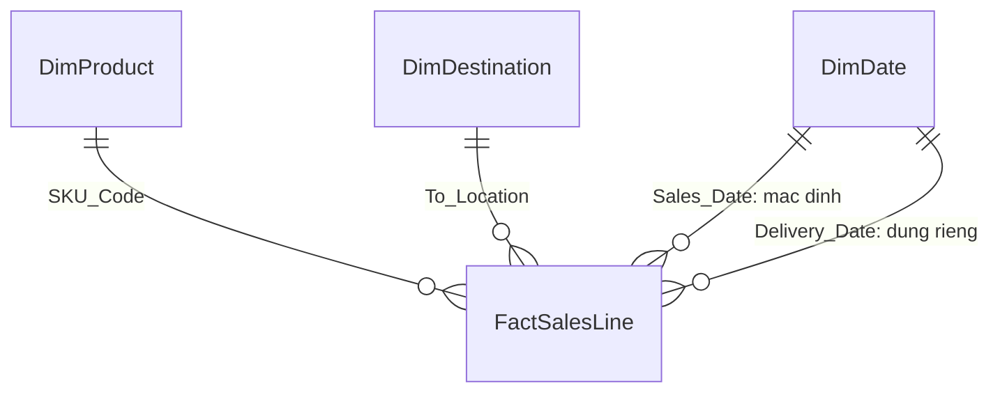

# Phase 3 — Tổ chức dữ liệu trong Power BI

Model đã được kiểm trên dữ liệu của lượt chạy lại; **chờ bạn duyệt kết quả**.
Nguồn: [CSV đã duyệt](../data/processed/nile_sales_clean.csv), 9.705 dòng và 21 cột.
Dự án: [NileSales.pbip](../pbi/NileSales.pbip). Report hiện là trang nền; dashboard sẽ làm ở phase sau.

## 1. Các bảng dùng để làm gì

| Bảng trong Power BI | Cách hiểu | Số dòng |
|---|---|---|
| FactSalesLine — bảng chính | Một dòng CSV; giữ 18 cột nguồn và 3 cột truy về Excel | 9.705 |
| DimProduct — bảng sản phẩm | Mỗi mã SKU xuất hiện một lần, kèm nhóm Category của nó | 50 |
| DimDestination — bảng nơi nhận | Mỗi nơi nhận xuất hiện một lần, kèm loại City_Tier | 28 |
| DimDate — lịch | Mỗi ngày xuất hiện một lần, từ 01/01 đến 31/12/2025 | 365 |
| Measure — bảng công thức | Giữ 13 công thức cũ; chưa nghiệm thu chúng cho lượt chạy lại ở Phase 4 | Không phải bảng dòng bán hàng |

Bảng chính giữ mọi dòng/mã/cờ. Bảng cờ đa khách được giữ riêng, không dùng để loại dòng hoặc nối làm tăng số dòng.

## 2. Nối bảng và lọc dữ liệu

Một mã sản phẩm ở bảng sản phẩm có thể lọc nhiều dòng ở bảng chính; mỗi dòng chỉ nối với đúng một mã sản phẩm. Nơi nhận và ngày cũng theo cách đó. Bộ lọc đi từ bảng sản phẩm/nơi nhận/lịch xuống bảng chính, tránh tính trùng dòng.

**Mặc định lọc theo ngày bán.** Đường nối ngày giao được giữ không hoạt động mặc định và chỉ dùng khi yêu cầu xem theo ngày giao; hai đường ngày không cùng tự lọc.

Không nối bảng theo Order_ID/Customer_ID hoặc tạo khóa đơn mới. Order_ID được dùng như mã nhóm nguồn; chưa xác nhận đây là đơn kinh doanh.

## 3. Ví dụ và kết quả đã kiểm

Chọn **tháng 7 + Skincare**: còn **578 dòng**, số lượng **774**, giá trị ghi nhận **518.484** — khớp CSV. Skincare là nhóm sản phẩm, không phải một SKU duy nhất.

| Kiểm | Kết quả |
|---|---|
| Tổng dòng / số lượng / giá trị | 9.705 / 13.087 / 8.787.091, khớp CSV |
| Bộ lọc theo nhóm | Mọi nhóm trong 35 tháng × Category, 10 Category × City_Tier và 28 nơi nhận đều khớp dòng/số lượng/giá trị với CSV |
| Lịch và ngày nguồn | 365 ngày liên tục, không trùng/thiếu khóa; ngày bán và ngày giao đều trong lịch |
| Dấu vết về Excel | 9.705 bộ dấu vết duy nhất; đủ 7 sheet và khoảng số dòng khớp CSV |
| Lưu–mở lại | Sau lưu và mở lại, query trước refresh mới vẫn giữ đúng tổng và giá trị tháng 7 + Skincare |

Ngày giao 06/08 có 5 dòng, giá trị 3.321 khi lọc riêng theo ngày giao. Lọc tháng 8 theo ngày bán cho kết quả trống vì file không có dòng bán tháng 8; không tự điền 0 vào dữ liệu.

## 4. Phạm vi được dùng và giới hạn

Model hỗ trợ mô tả số lượng/giá trị ghi nhận theo tháng, nhóm sản phẩm và nơi nhận. Lịch đủ năm không có nghĩa file có đủ giao dịch cả năm.

**H1 là giả định thực hành đã chọn, chưa xác nhận nguyên nhân thật.** Giữ mọi mã khách/dòng; chưa mở phân tích khách mua lại/giá trị khách. Giá trị đơn bình quân cần định nghĩa đơn và cách tính giá trị đơn; nhiều khách trong mã nhóm không tự làm sai phép cộng theo nhóm.

Tiền tệ, thuế/chiết khấu, ý nghĩa Is_Returned và ngày giao thực tế hay dự kiến còn chưa rõ. Chưa dùng dữ liệu này để kết luận doanh thu thuần, tỷ lệ đơn hoàn hoặc giao đúng hạn. Những công thức/report cũ được giữ lại và sẽ kiểm riêng ở phase tương ứng.
