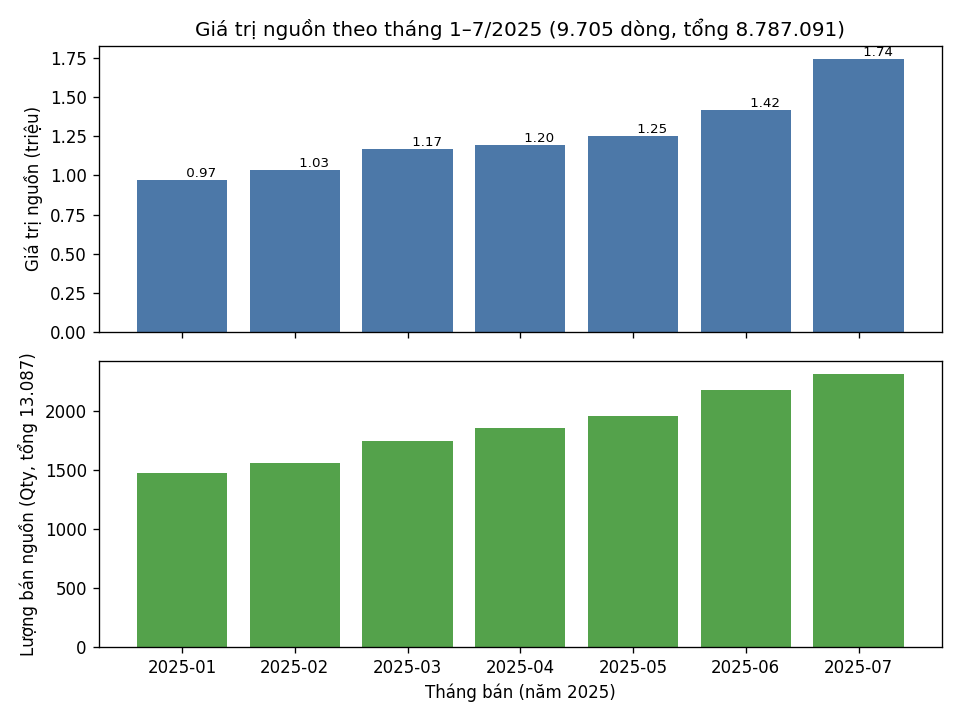
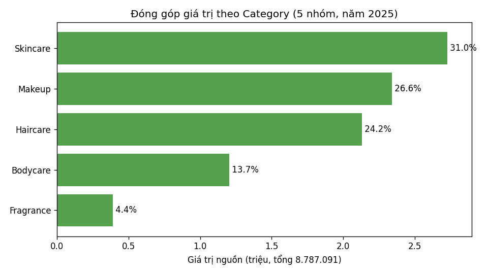
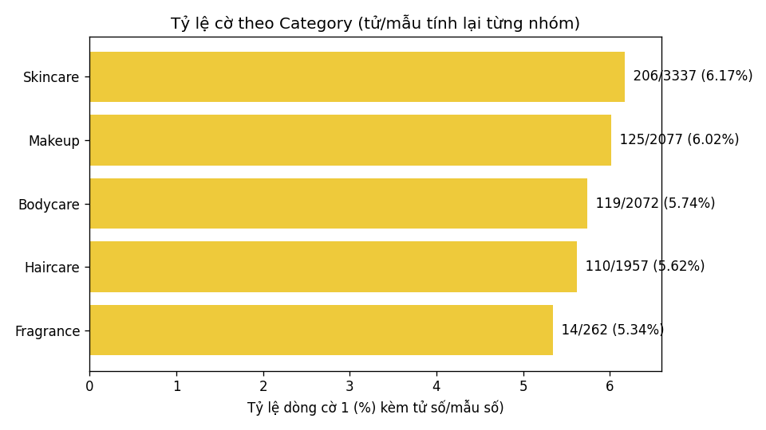
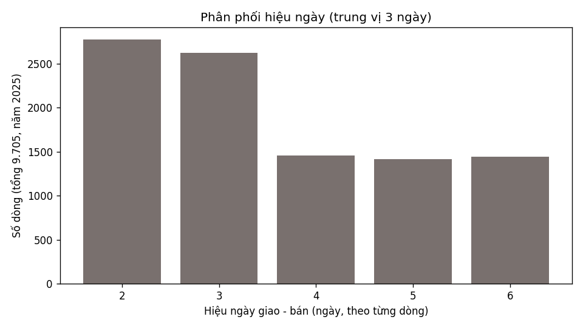

# Phase 4B — bốn câu hỏi về bộ dữ liệu (9.705 dòng, tháng 1–7/2025)

> Nguồn duy nhất: `data/processed/nile_sales_clean.csv` (SHA `e0094388…`).
> Kỳ bán theo ngày bán; dòng giao sang tháng 8 vẫn tính vào tháng bán.
> H1 chỉ là giả định thực hành (mã nhóm nguồn; chưa xác nhận `Order_ID` là đơn thật).
> Mọi số chỉ mô tả file. Qty là lượng ghi trong nguồn; SKU là mã sản phẩm; Category là nhóm sản phẩm. Giá trị chưa xác nhận tiền tệ, thuế hay phần hoàn. Bảng số: `reports/phase4b/*.csv`.

## 1. Lượng và giá trị thay đổi thế nào theo tháng?

| Tháng | Dòng | Qty | Giá trị | So tháng trước |
|---|---|---|---|---|
| 2025-01 | 1.094 | 1.472 | 968.478 | — |
| 2025-02 | 1.167 | 1.562 | 1.031.819 | +6,5% |
| 2025-03 | 1.276 | 1.746 | 1.170.399 | +13,4% |
| 2025-04 | 1.376 | 1.859 | 1.197.475 | +2,3% |
| 2025-05 | 1.473 | 1.956 | 1.253.697 | +4,7% |
| 2025-06 | 1.597 | 2.182 | 1.421.195 | +13,4% |
| 2025-07 | 1.722 | 2.310 | 1.744.028 | +22,7% |

(`monthly.csv`; hình dưới: khung trên giá trị theo triệu, khung dưới Qty — hai đơn vị khác nhau vẽ riêng.)

Qty và giá trị đi cùng chiều cả 7 tháng nhưng không cùng mức: T7 giá trị +22,7%
trong khi Qty +5,9% (2.310 so 2.182) và dòng +7,8% — tháng 7 tăng mạnh ở giá trị
hơn ở khối lượng. Tháng 4 giá trị tăng chậm (+2,3%); lượng tăng 6,5% và số dòng tăng 100.

Mổ cú tăng T7 (+322.833, cộng đúng từng nhóm trong `t7_decomp.csv`): nhóm tăng
gồm Makeup +159.095, Skincare +87.280, Haircare +85.493; nhóm giảm gồm Bodycare
−8.608 và Fragrance −427. Hai SKU Makeup BPC-1041 (T6 60.405 → T7 104.266,
chênh +43.861) và BPC-1048 (T6 46.994 → T7 97.594, chênh +50.600) cộng lại tăng
+94.461, tức khoảng 29% cú nhảy T7 (`sku_jun_jul.csv`); cả hai bán đủ 7 tháng
nên đây không phải hàng mới xuất hiện. Bảng đủ 50 SKU (dòng/Qty/giá trị/tỷ trọng)
ở `sku_all.csv`.

Ý nghĩa: muốn hiểu T7 thì nhìn Makeup — nhưng đó mới là quan sát cộng dồn.
Giới hạn: số ngày bán phủ kín lịch mỗi tháng là quan sát, chưa xác nhận đủ giao
dịch; các tháng dài ngắn khác nhau (28–31 ngày) nên so tổng tháng chỉ là mô tả —
tính hỗ trợ theo ngày (giá trị/ngày bán: T6 47.373, T7 56.259, vẫn cao nhất) cũng
không đổi kết luận. Không suy nguyên nhân, không ngoại suy cả năm.

## 2. Nhóm nào đóng góp chính?

Toàn kỳ (`contrib_category.csv`, hình dưới): Skincare 31,0% (17 SKU), Makeup
26,6% (10 SKU), Haircare 24,2% (10 SKU) — ba nhóm đầu ≈ 81,9%; Bodycare 13,7%
(11 SKU), Fragrance 4,4% (2 SKU).

Nơi nhận (`destination.csv`, 28 nơi, tỷ trọng tổng 1): Bengaluru 678.661 lớn
nhất, kế đến Kolkata 676.437. Gộp nhóm sản phẩm × nhóm nơi nhận (Category × City_Tier) (`combo_cat_tier.csv`): ô lớn
nhất Skincare–Metro 18,6%, kế đến Makeup–Metro 15,4%.

Ý nghĩa: Skincare/Makeup là trọng tâm khi tìm hiểu tiếp, nhưng SKU nhiều chưa
chứng minh được ưa chuộng hơn. Giới hạn: chưa có lợi nhuận/tồn kho nên không
quyết định nhập hàng hay khuyến mãi; không ép quy luật 80/20.

## 3. Dòng cờ 1 nằm ở những đâu?

Toàn kỳ 574/9.705 = 5,91% (`returns_month/category/location.csv`; tỷ lệ nào cũng
tính lại tử/mẫu, kèm số dòng — hình dưới).

Theo tháng: 4,70% (T7: 81/1.722) đến 6,82% (T3: 87/1.276). Theo Category:
Skincare 206/3.337 (6,17%), Makeup 125/2.077 (6,02%), Bodycare 119/2.072
(5,74%), Haircare 110/1.957 (5,62%), Fragrance 14/262 (5,34%). Theo nơi nhận:
Vadodara 5/195 (2,56%) đến Nashik 18/216 (8,33%).

Đọc đúng mức: các tỷ lệ Category nằm trong khoảng hẹp 5,34–6,17% và nhóm nhiều
cờ nhất cũng là nhóm nhiều dòng nhất — không đủ bằng chứng nói cờ dồn vào đâu.
Nhóm ít mẫu (Fragrance 262 dòng; Nashik 216 dòng) thì tỷ lệ kém vững, không xếp
hạng ưu tiên chỉ vì tỷ lệ cao, cũng không ép kiểm thống kê để có kết luận.
Giới hạn: đây là cờ mức dòng, chưa phải số đơn hoàn, tiền hoàn hay nguyên nhân.

## 4. Hiệu ngày bán–giao khác nhau thế nào?

Hiệu ngày chỉ nhận 5 giá trị 2–6 ngày, dồn ở 2–3 ngày (5.393/9.705 dòng);
trung vị toàn file 3 ngày (`leadtime_dist.csv`, hình dưới).

Theo nơi nhận (`leadtime_location.csv`, `leadtime_from_to.csv`): Kolkata trung vị
5 ngày trên cả 3 tuyến vào (Gurgaon 273, Navi Mumbai 237, Hyderabad 217 dòng).
Cùng nơi gửi Hyderabad để so ngang hàng: Bengaluru 542 dòng trung vị 2,
Hyderabad 511 dòng trung vị 2, Chennai 458 dòng trung vị 3, Kolkata 217 dòng
trung vị 5 — quan sát cho thấy nơi nhận khác nhau thì số giữa khác nhau dù chung
nơi gửi. Trung vị luôn tính từ các dòng của từng tập, không cộng hay lấy trung
bình các trung vị nhóm.

Đọc đúng mức: đây vẫn chỉ là quan sát (3 tuyến vào Kolkata), chưa chứng minh do
nơi nhận và chưa loại trừ khác biệt cơ cấu dòng; ngày trong file có thể là ngày
dự kiến, chưa có hạn giao chuẩn nên không gọi là giao chậm/đúng hạn.

## 5. Một việc ưu tiên (đề xuất, chưa chốt)

**So cơ cấu dòng tháng 6 với tháng 7 của 2 SKU BPC-1041/1048** (phân bố nơi nhận, Qty, giá từng dòng và dấu vết sheet/dòng Excel) để xem phần tăng +94.461 nằm ở nơi nào và đi cùng thay đổi lượng hay giá ghi nhận. Chưa gọi một dòng là lỗi chỉ vì khác biệt. Lý do: đây là phần tăng T7 có thể
chỉ mặt gọi tên (~29%). Vai trò: người phân tích rà bảng `sku_jun_jul.csv` +
dòng chi tiết; vận hành dùng kết quả để quyết định có cần hỏi tiếp về tồn kho
hay đợt bán (hiện chưa có dữ liệu đó). Cách đo: đạt khi bảng so T6–T7 theo nơi nhận của 2 SKU cộng đúng phần tăng +94.461 và chỉ ra được thay đổi lượng/giá cần tìm hiểu tiếp.
Điều kiện: chỉ trong file thực hành này; chưa chốt người làm, mục tiêu hay kỳ
thử; không nhận đã triển khai, không nói hiệu quả.
