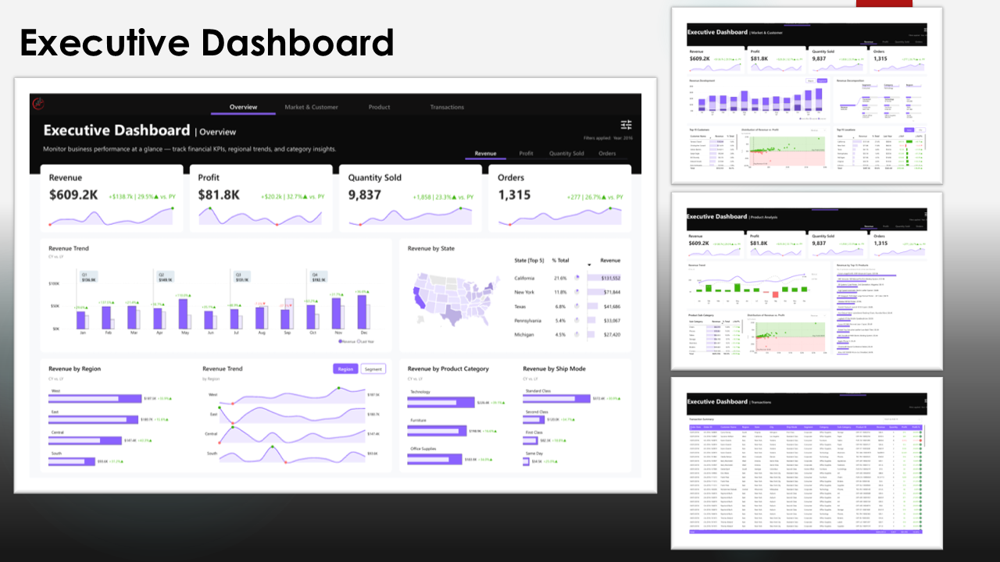
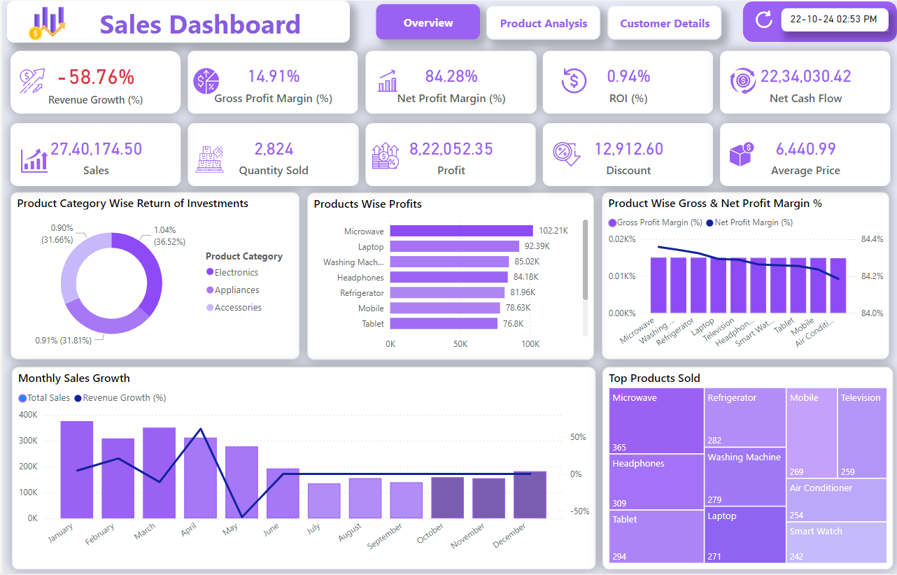
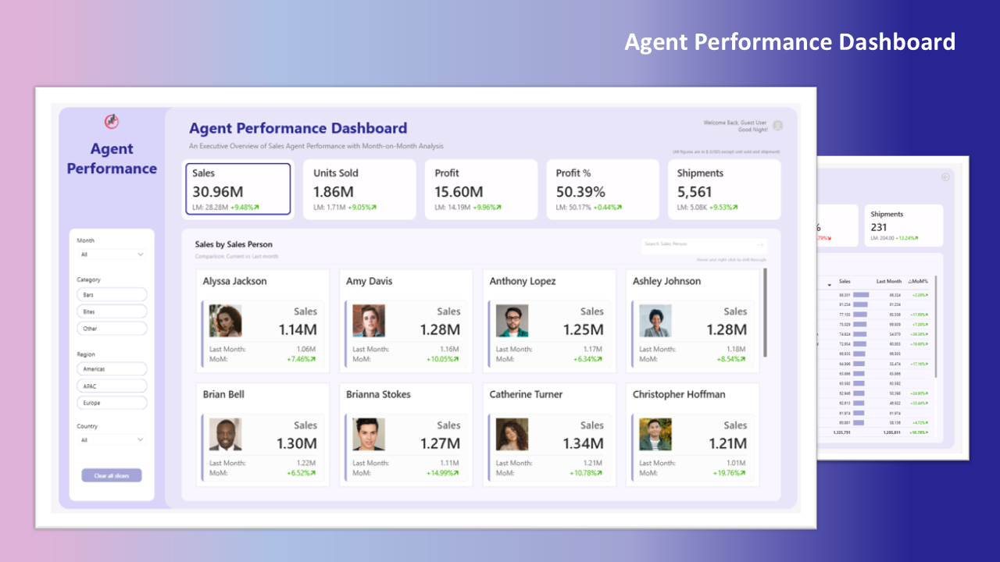
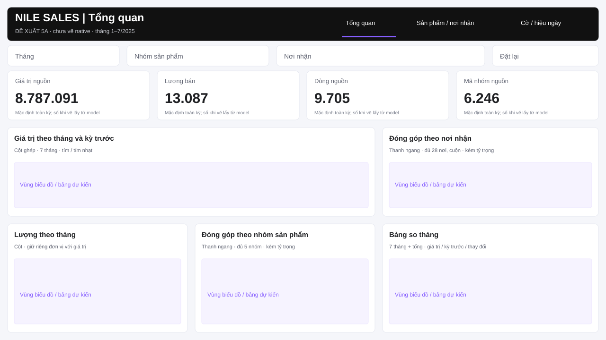

# Phase 5A — chọn mẫu và điều chỉnh cho Nile Sales

**Người dùng đã chốt mẫu1 — Executive Dashboard và giao vẽ theo mapping này ngày15/10/2026. Bản native hiện hành ở [doc5B](05b_dashboard_build.md).**

Bạn đọc theo thứ tự: **ba ảnh mẫu → đề xuất và sơ đồ → bảng nội dung/lọc → quyết định cuối tài liệu.** Nguồn chung: [Themes Gallery Microsoft](https://community.fabric.microsoft.com/category/pbi_comm_galleries/discussions/themesgallery).

## 1. Ba mẫu đã xem

### Mẫu 1 — Executive Dashboard · đề xuất

[Nguồn: Arbaz_Ahmad](https://community.fabric.microsoft.com/discussions/themesgallery/executive-dashboard/4724648) · [JSON gốc đã tải](../reports/phase5a/template_executive.json).

Giữ: thanh tiêu đề/điều hướng đen, nền sáng, bốn ô số, lưới biểu đồ và bảng, màu tím `#865EFF`/tím nhạt `#ECE6FF`. Phù hợp để đọc từ tổng quan xuống nhóm/sản phẩm. JSON này **chỉ có bảng màu**; bố cục, chữ, thẻ và thanh tiêu đề phải dựng theo ảnh, không tự xuất hiện khi import.

### Mẫu 2 — Sales Analytics Report Insights

[Nguồn: SSSBI](https://community.fabric.microsoft.com/discussions/themesgallery/sales-analytics-report-insights/4254435) · [JSON đã chuẩn hóa cú pháp](../reports/phase5a/template_sales_insights.json).

Nhiều dạng hình: vòng, thanh ngang, cột–đường kết hợp, ô diện tích; thẻ trắng/tím và bóng rõ. Có thể thay nội dung bằng dữ liệu Nile, nhưng nhiều ô lợi nhuận/ROI/dòng tiền không có dữ liệu để dùng. JSON gốc có xuống dòng chưa escape trong chuỗi font; bản tải đã sửa **cú pháp**, giữ nguyên các giá trị. Tệp gốc nằm trong evidence; chưa kiểm import native.

### Mẫu 3 — Performance Dashboard — Sales Agent

[Nguồn: Arbaz_Ahmad](https://community.fabric.microsoft.com/discussions/themesgallery/performance-dashboard---sales-agent/4835810) · [JSON gốc đã tải](../reports/phase5a/template_agent_performance.json).

Thanh lọc trái, ô số trên, các thẻ nhân viên ở giữa; tím đậm `#282492` và tím nhạt `#A1A2D3`. Nile không có nhân viên bán hàng/ảnh; thay các thẻ người bằng sản phẩm sẽ làm đổi phần đặc trưng của mẫu khá nhiều. Vì vậy tôi không ưu tiên mẫu này.

| Tiêu chí cho Nile | Mẫu 1 | Mẫu 2 | Mẫu 3 |
|---|---|---|---|
| Đọc tổng quan → đóng góp → chi tiết | Thuận | Nhiều ô cần rút gọn | Thiên về từng nhân viên |
| Áp dụng mà không thêm KPI thiếu dữ liệu | Đổi nhãn/chỉ số và các vùng so năm/bản đồ | Bỏ nhiều ô tài chính | Đổi toàn bộ khu nhân viên |
| JSON tải được/đọc được | Có; giữ nguyên | Có; sửa cú pháp xuống dòng | Có; giữ nguyên |
| Khuyến nghị | **Chọn mẫu 1** | Phương án nếu thích nhiều kiểu hình | Ít phù hợp nhất |

## 2. Áp dụng mẫu 1: giữ format, thay nội dung bằng dữ liệu

**Mẫu1 và cách áp dụng dưới đây đã được người dùng chốt.** Giữ theme và cách chia vùng của mẫu 1; không đổi sang bố cục C GitHub cũ, không tự đổi thành nền xanh–vàng.

| Thành phần trong mẫu | Áp dụng cho Nile | Vì sao cần đổi |
|---|---|---|
| 4 ô Revenue / Profit / Quantity / Orders | Giá trị nguồn / Lượng bán / Dòng nguồn / Mã nhóm nguồn | Không có lợi nhuận; Order_ID chưa là đơn thật |
| Cột so năm trước | Cột ghép giá trị tháng và tháng trước | Chỉ có T1–T7/2025; có measure so tháng, không có dữ liệu năm trước |
| Bản đồ bang/khu vực | Ô diện tích nơi nhận; thanh nơi nhận ở trang2, kèm tỷ trọng | Cần so đóng góp 28 nơi; không có tọa độ/định nghĩa địa lý đã chuẩn hóa |
| Nhóm sản phẩm / hình nhỏ theo vùng | Vòng 5 nhóm và cột lượng theo tháng | Có Category và Qty, dùng đúng đơn vị riêng |
| Trang Product / Transactions | Trang Sản phẩm–nơi nhận và Cờ–hiệu ngày | Giữ cách chia trang; thay nội dung bằng câu hỏi đã chốt |
| So năm, lợi nhuận, khách hàng, cách giao | So tháng, cờ mức dòng, mẫu và trung vị hiệu ngày | Không bê chỉ số ngoài 13 measure đã duyệt |

Màu theo JSON nguồn; chữ Segoe UI đọc được, nhãn tiếng Việt, số có phân tách nghìn. Không tô màu “đạt/không đạt” khi chưa có mục tiêu. Mặc định khung **1280 × 720**, lề ngoài **16 px**; title/nav trên, lọc bên dưới, ô số rồi lưới hình/bảng. Bỏ logo và tên thương hiệu tác giả; không giữ số mẫu trong report Nile.

## 3. Ba trang sẽ vẽ khi bạn duyệt

| Trang | Câu hỏi và nội dung | Dạng hình / trường / chỉ số |
|---|---|---|
| **1. Tổng quan theo tháng** | Giá trị và lượng thay đổi thế nào; nhóm/nơi nào đóng góp? | 4 ô tổng; cột giá trị + đường % thay đổi theo YearMonth; cột Qty riêng; vòng Category và ô diện tích nơi nhận + tỷ trọng; bảng tháng gồm giá trị/tháng trước/% |
| **2. Sản phẩm và nơi nhận** | Mã nào đóng góp; đọc từng mã qua tháng? | Giữ 4 ô tổng theo phạm vi chọn; chấm 50 SKU (Qty × giá trị, cỡ = số dòng), bảng 50 SKU + Category/dòng/Qty/giá trị/tháng trước/%; thanh nhóm và 28 nơi nhận + tỷ trọng; bảng đủ mã, cuộn để xem |
| **3. Cờ nguồn và hiệu ngày** | Cờ 1 ở đâu; hiệu ngày ở đâu dài hơn và mẫu bao nhiêu? | 4 ô cờ1/tỷ lệ/trung vị/mẫu ngày; chấm Category (mẫu cờ × tỷ lệ, cỡ = số dòng cờ1); đường tỷ lệ theo tháng + mẫu tooltip; bảng cờ theo nơi nhận; bảng tuyến gửi→nhận + mẫu/trung vị |

Hai vùng nhóm/nơi bổ sung ở Tổng quan và các ô tổng ở trang 2 giúp giữ lưới của mẫu; **13 measure vẫn giữ nguyên**, không coi 13 vùng cũ là số lượng bắt buộc. Theo phản hồi “biểu đồ còn khá cơ bản” và yêu cầu tiếp tục chỉnh trang2/3 ngày15/10/2026, Codex đổi loại hình thành cột–đường/vòng/ô diện tích/chấm/đường; giữ theme/lưới mẫu1. Đây là điều chỉnh được người dùng yêu cầu, không đổi sang mẫu2.

**Vị trí đề xuất trang 1** (x, y, rộng, cao; đã kiểm không chồng/vượt khung):

| Vùng | Vị trí |
|---|---|
| Tiêu đề + 3 nút trang | 16,16,1248,70 |
| Lọc tháng/nhóm/nơi nhận/reset | 16,96,1248,44; khi vẽ cần kiểm chiều cao slicer native, điều chỉnh trong khung nếu chữ bị cắt |
| 4 ô số | x=16/332/648/964; y=150; 300×104 |
| Giá trị theo tháng / nơi nhận | 16,270,776,188 / 808,270,456,188 |
| Lượng / nhóm / bảng tháng | 16,474,380,230 / 412,474,380,230 / 808,474,456,230 |

Trang2 dùng cùng title/lọc/ô số; chấm SKU phía trên bảng chi tiết bên trái, hai thanh nhóm/nơi bên phải. Hai vùng trái lần lượt16,336,792,176 và16,528,792,176. Trang 3 thêm lọc nơi gửi/cờ trong phạm vi trang; hai hàng bảng/hình kèm mẫu. Lọc cục bộ phải có chỗ đủ đọc, không ép vào lưới đến mức cắt chữ; vị trí cuối kiểm bằng ảnh native ở 5B.

## 4. Bộ lọc và cách đọc số

| Thao tác | Phải làm được khi kiểm |
|---|---|
| Tháng/nhóm/nơi nhận | Đồng bộ 3 trang, tác dụng lên số/hình/bảng; mặc định T1–T7/2025, tất cả nhóm/nơi |
| SKU ở trang 2 | Lọc các vùng trang 2; không áp sang trang 1/3; không cố định chỉ còn BPC-1041/1048 |
| Nơi gửi/cờ 0–1 ở trang 3 | Chỉ lọc trang 3, cả phần cờ và ngày |
| Chọn thanh nhóm/nơi | Lọc bảng chi tiết được chỉ định; không vô tình đổi mẫu số của tỷ trọng |
| Chuyển trang | Giữ lọc chung, xóa lựa chọn cục bộ khi rời trang |
| Reset | Bỏ lọc chung/cục bộ và lựa chọn trên hình về mặc định |
| Không có dòng / nhiều tháng | Không có dòng → trống; so tháng ngoài điều kiện → trống; có mẫu nhưng không cờ1 → 0 |

Bốn tổng để đối chiếu mặc định: **8.787.091 / 13.087 / 9.705 / 6.246**. Bảng tháng: T7 **1.744.028**, tháng trước **1.421.195**, thay đổi **22,72%**; T1 và tổng nhiều tháng trống ở hai cột so kỳ. Cờ **574/9.705 = 5,91%**; trung vị **3 ngày**, mẫu ngày **9.705**. Skincare **2.727.493/8.787.091 ≈ 31,04%**.

Nguồn định nghĩa: [doc measure](04_measures.md); ý nghĩa/phát hiện: [doc phân tích](04b_findings.md). H1 vẫn là giả định thực hành; giá trị chưa xác nhận tiền tệ, cờ không là tiền hoàn, hiệu ngày chưa là SLA. Không lợi nhuận/ROI/YoY/giữ chân khách/giá trị đơn bình quân.

## 5. Đã kiểm và bạn duyệt gì

Đã mở/xem đúng ba bài trong gallery, xem ba ảnh thật, tải và đọc ba JSON; kiểm sơ đồ không chồng/vượt khung và đường dẫn. Mẫu 1/3 JSON gốc không đổi; mẫu 2 chỉ chuẩn hóa cú pháp, bản gốc giữ trong evidence. **Chưa kiểm import theme, render hay thao tác native của thiết kế mới**; các ảnh mẫu chứa số của tác giả, sơ đồ là đề xuất, không phải ảnh Power BI Nile đã vẽ.

**Đã chốt mẫu1 theo “chốt mẫu 1 vẽ dashboard đi nhé làm nhanh lên nhé”.** Không cần chọn lại; xem [đầu ra5B](05b_dashboard_build.md) để review bản vẽ. Các ảnh/sơ đồ ở doc5A vẫn là tài liệu thiết kế, không thay ảnh native5B.
