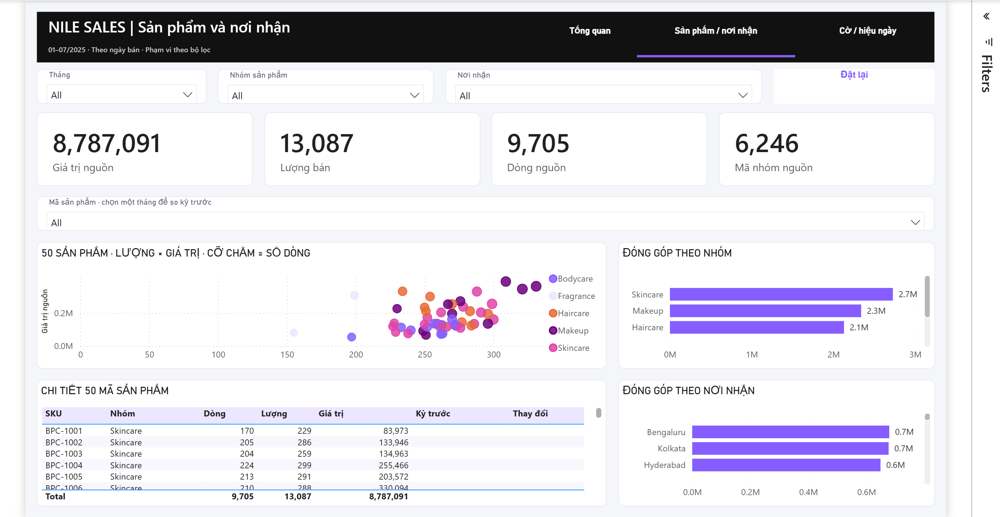

# Phase 5B — dashboard Nile Sales theo mẫu 1

**Đã bổ sung biểu đồ cho cả ba trang theo phản hồi của bạn.** Giữ thanh đen, nền sáng và bảng màu Executive Dashboard. Mở [NileSales.pbip](../pbi/NileSales.pbip), hoặc xem ảnh native sau lưu–mở lại dưới đây.

Thiết kế gốc: [Executive Dashboard — Microsoft Gallery](https://community.fabric.microsoft.com/discussions/themesgallery/executive-dashboard/4724648). Mapping hiện hành ở [doc 5A](05a_dashboard_plan.md); loại hình được điều chỉnh theo yêu cầu tăng tính trực quan, không đổi mẫu/theme.

## 1. Tổng quan theo tháng

- **Cột–đường:** cột là giá trị nguồn, trục trái theo triệu; đường là phần trăm thay đổi so tháng trước, trục phải. T7 đạt **1.744.028**, tăng **22,72%**. T1 chưa có kỳ trước nên không có điểm phần trăm; không điền 0.
- **Vòng tròn:** cơ cấu giá trị của năm nhóm; Skincare **31,04%**. Nhãn làm tròn một chữ số nên có thể không cộng đúng 100%.
- **Ô diện tích:** đủ 28 nơi nhận, diện tích tỷ lệ với giá trị. Ô nhỏ có thể ẩn/rút gọn tên; dùng thanh cuộn nơi nhận ở trang 2 để đối chiếu. Màu phân biệt nhóm, không là thang tốt/xấu.
- Giữ hình lượng riêng và bảng so kỳ chính xác. Bốn tổng mặc định **8.787.091 / 13.087 / 9.705 / 6.246**; T1/tổng nhiều tháng trống ở hai cột so kỳ.

Cột–đường dùng hai trục riêng cho hai đơn vị; không suy quan hệ nhân quả từ việc các đường/cột đi cùng nhau. [Cách dùng trong Power BI](https://learn.microsoft.com/en-us/power-bi/visuals/power-bi-visualization-combo-chart).

## 2. Sản phẩm và nơi nhận

**Mỗi chấm là một mã sản phẩm:** sang phải là lượng nhiều hơn, lên cao là giá trị cao hơn, chấm lớn là nhiều dòng nguồn hơn. Có đủ **50 mã**; các chấm có thể chồng nhau. Màu phân biệt năm nhóm và thống nhất với trang 1/3 trong bản native.

Hình giúp tìm mã bán lượng tương đương nhưng giá trị khác nhau để xem tiếp giá/cơ cấu sản phẩm; không nhận đó là lợi nhuận hay hiệu quả. Bảng 50 mã ở dưới vẫn giữ đủ cột, cuộn để tra từng mã. Chọn một tháng đầy đủ để hiện so kỳ; mặc định nhiều tháng để trống. Thanh nhóm/nơi nhận bên phải vẫn đủ 5 nhóm/28 nơi, cuộn để đọc.

## 3. Cờ nguồn và hiệu ngày

**Chấm nhóm sản phẩm:** trục ngang là số dòng có cờ hợp lệ, trục dọc là tỷ lệ cờ 1, cỡ chấm là số dòng cờ 1. Skincare **206/3.337 = 6,17%**; Fragrance **14/262 = 5,34%** có mẫu nhỏ hơn nhiều. Đọc tỷ lệ cùng quy mô, không xếp ưu tiên chỉ vì tỷ lệ cao.

**Đường theo tháng:** T3 **87/1.276 = 6,82%**, T7 **81/1.722 = 4,70%**. Đây là thay đổi quan sát trong file; chưa chứng minh vận hành cải thiện. Mẫu tháng đã gắn vào tooltip, thao tác hover còn cần QA.

Giữ bốn ô tổng **574 / 5,91% / 3 ngày / 9.705 dòng**, bảng cờ theo nơi nhận và bảng tuyến có mẫu/trung vị. Hai hình mới thay bảng cờ theo nhóm và thanh trung vị theo nơi nhận trước đó; trung vị vẫn đọc ở thẻ/bảng tuyến. Không cộng tỷ lệ hoặc trung vị giữa các nhóm. Cờ nguồn chưa được xác nhận là hoàn thực tế hoặc tiền hoàn; hiệu ngày chưa là giao đúng hạn.

## Đã kiểm và giới hạn

- Đã đối chiếu DAX: 50 mã, 5 nhóm, 28 nơi, 7 tháng và tổng/nhóm/tỷ lệ. Đã render ba trang, lưu, đóng bình thường, mở lại đúng project và xem ảnh đủ nội dung.
- Giữ nguồn/CSV/notebook/doc0–4B, định nghĩa bảng/quan hệ và 13 công thức. **19/20 tệp bảo vệ giữ nguyên byte**; Desktop cập nhật `cultures/en-US.tmdl` với từ đồng nghĩa do đổi nhãn hình (`PowerBI.VisualColumnRename`), không sửa phép tính.
- Khung 1280×720, lề16px; 20/20/21 khung hình. Chạy `python -X utf8 scripts/build_dashboard.py --check-charts` để kiểm nhóm điểm và đơn vị hai trục mà không ghi report.
- CLI **0 lỗi/13 cảnh báo**: 12 cảnh báo chiều cao slicer đã đối chiếu ảnh; nhãn/All đọc được. Một cảnh báo schema visualContainer2.13 chưa tải được, chưa nhận toàn bộ schema đã kiểm xong.
- **Phase6 còn:** lọc đồng bộ/nhiều lựa chọn/rỗng, chọn chấm/thanh, hover, nav/reset. Chưa triển khai xóa riêng SKU/nơi gửi/cờ khi rời trang; ClearAllSlicers chưa chứng minh xóa lựa chọn trên hình. Ảnh nhỏ có chấm chồng, nhãn ô diện tích rút gọn và màu nhạt theo palette gốc; bảng/nhãn/chú giải hỗ trợ đọc, chưa nghiệm thu khả năng tiếp cận toàn bộ.

H1 vẫn là giả định thực hành; mã nhóm chưa là đơn thật, tiền tệ chưa xác nhận. **Chờ bạn review hình thức; Gate5B/6 chưa tự duyệt.** Bằng chứng hiện hành ở `Log/phase5b/evidence/run.json.chartRefinement`; bạn không cần đọc Log để xem sản phẩm.
