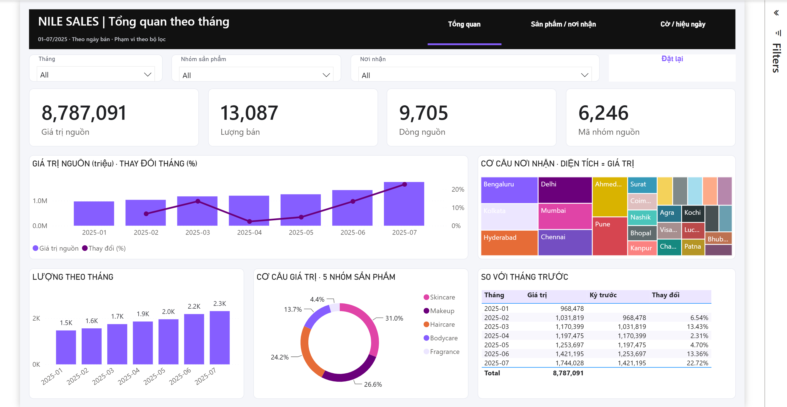
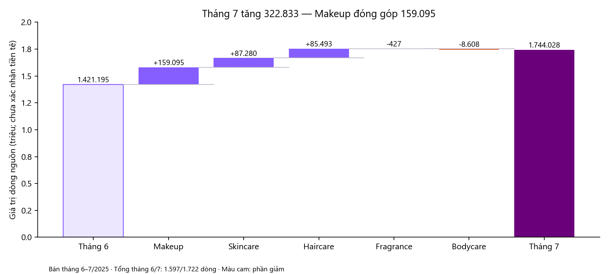
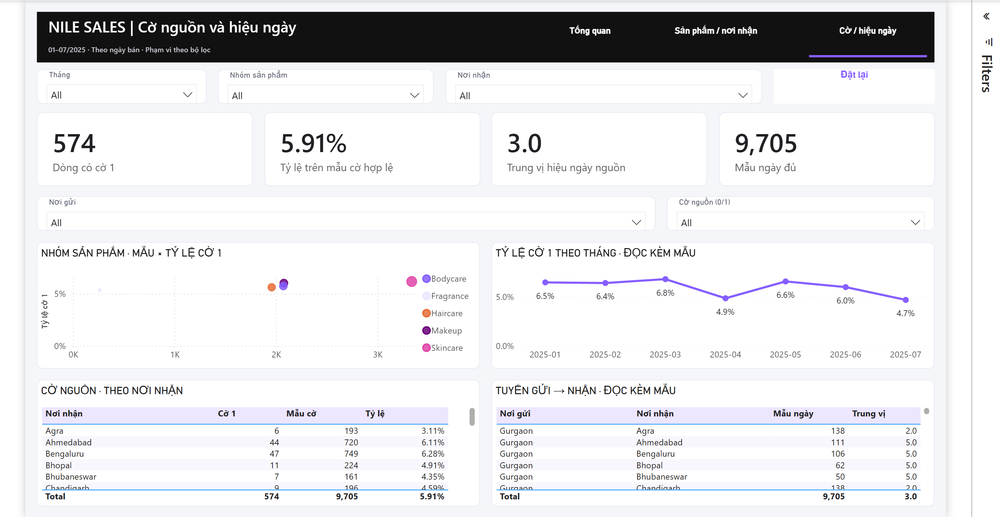
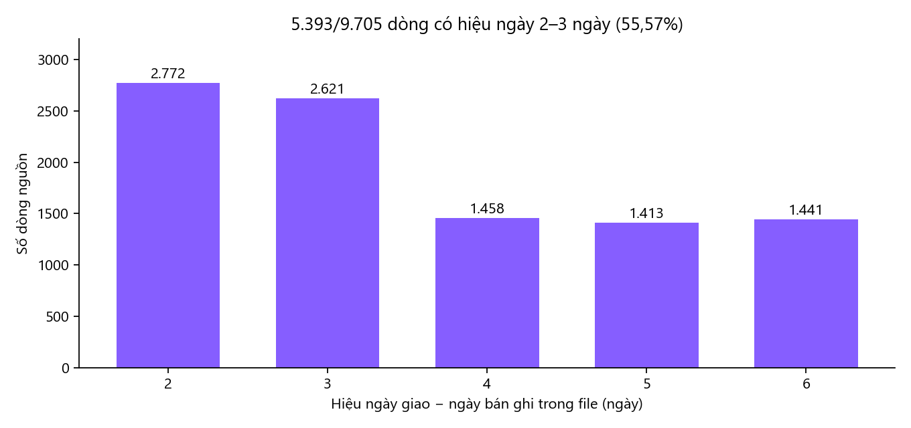

# Phase 6 — duyệt nội dung và báo cáo bàn giao

**Trạng thái: chờ bạn duyệt.** Bạn đọc nội dung báo cáo phía dưới; sản phẩm bàn giao là [file TEX](../reports/06_business_report.tex), kèm ảnh được dẫn bằng đường dẫn tương đối.

**Trình tự:** [PLAN](../Plan/PLAN.md) → doc Phase6 này → bạn duyệt nội dung/bản báo cáo → chốt bản TEX để bàn giao. Bản TEX hiện được chuẩn bị để kiểm và review, chưa tự coi là bản đã được bạn nghiệm thu. Theo lệnh “compile đi”, đã biên dịch [PDF từ TEX](../reports/06_business_report.pdf) để bạn đọc/duyệt; TEX vẫn là tệp nguồn bàn giao. Bản báo cáo chưa tự được nghiệm thu.

**Mẫu trình bày đã chọn:** [báo cáo GiaoNgon](https://github.com/lehoanggiavi/GiaoNgon/blob/HEAD/docs/bao_cao_ban_giao.pdf) theo yêu cầu của bạn. Áp dụng bìa nền màu, trang thông điệp với ba số lớn, khung quyết định, chú thích hình, bảng gọn và đầu/cuối trang. Giữ màu tím và dữ liệu Nile Sales; không sao nội dung/ngày/số của GiaoNgon. Xem [bìa hiện hành](../reports/phase6/report_cover.png) và [trang tóm tắt](../reports/phase6/report_summary.png).

Bạn cần xem: câu chuyện có trả lời bốn câu hỏi không; số/hình và giới hạn có rõ không; đề xuất đối chiếu hai mã Makeup có phù hợp không. Duyệt báo cáo không là giao triển khai đề xuất hoặc duyệt các thao tác dashboard chưa kiểm.

---

# Nội dung báo cáo — phần tăng tháng 7 đến từ đâu?

**Báo cáo phân tích tháng 1–7/2025 · Ngày lập: 15/10/2026**  
Dành cho người phụ trách bán hàng/vận hành đọc bộ dữ liệu thực hành. Phạm vi: 9.705 dòng, 50 mã sản phẩm, 5 nhóm và 28 nơi nhận.

## Điều cần quyết định

**Ưu tiên tìm hiểu hai mã Makeup BPC-1041 và BPC-1048 trong tháng 6–7.** Hai mã này đóng góp **94.461, tương đương 29,26% phần tăng giá trị tháng 7**. Đây là một phạm vi nhỏ, có thể đối chiếu từng dòng trước khi đưa ra quyết định rộng hơn.

Lý do: tháng 7, giá trị nguồn tăng **22,72%**, trong khi lượng chỉ tăng **5,87%** so tháng 6. Chỉ nhìn lượng tăng chưa giải thích được vì sao giá trị tăng nhanh hơn. Cần xem thêm giá ghi nhận và cơ cấu sản phẩm/nơi nhận; báo cáo chưa xác định nguyên nhân.

Ba nhóm Skincare, Makeup và Haircare đóng góp **81,90% giá trị toàn kỳ**. Cờ nguồn và hiệu ngày có khác biệt giữa các nhóm, nhưng chưa đủ định nghĩa để kết luận hoàn hàng thực tế hay giao chậm. Vì vậy, chưa dùng những số này để điều chỉnh chính sách hoàn hoặc đánh giá nhà vận chuyển.

## 1. Giá trị tăng đều, nhưng tháng 7 đáng tìm hiểu hơn cả

Giá trị nguồn tăng từ **968.478 ở tháng 1 lên 1.744.028 ở tháng 7**. Trong bảy tháng quan sát, tháng 7 có mức tăng so tháng trước cao nhất.

*Ảnh Power BI thật ở phạm vi mặc định: tất cả tháng, nhóm và nơi nhận. Đọc cột giá trị theo trục trái; đường phần trăm theo trục phải. Tháng 1 chưa có kỳ trước nên phần trăm để trống.*

| Chỉ tiêu | Tháng 6 | Tháng 7 | Thay đổi |
|---|---:|---:|---:|
| Giá trị dòng nguồn | 1.421.195 | 1.744.028 | +322.833; **+22,72%** |
| Lượng ghi nhận | 2.182 | 2.310 | +128; **+5,87%** |
| Số dòng nguồn | 1.597 | 1.722 | +125 |

Điều này giúp thu hẹp câu hỏi: **phần tăng giá trị nằm ở những sản phẩm nào, có đi cùng thay đổi lượng hoặc giá ghi nhận không?** Tổng tháng chưa trả lời được câu hỏi đó.

Tháng 7 có 31 ngày, tháng 6 có 30 ngày. Khi chia giá trị cho số ngày lịch, mức tăng vẫn là **18,76%**. Chênh lệch độ dài tháng không giải thích hết biến động. Đây chỉ là phép chuẩn hóa theo lịch; chưa xác nhận file chứa đủ mọi giao dịch và không suy thành tăng trưởng của toàn doanh nghiệp.

*Nguồn số: [bảng tháng](../reports/phase4b/monthly.csv); đối chiếu lại từ CSV sạch theo ngày bán. “Giá trị” là tổng Line_Amount, chưa xác nhận tiền tệ hoặc doanh thu thuần.*

### Makeup đóng góp gần một nửa phần tăng tháng 7

*Hai cột đầu/cuối là tổng tháng 6/7. Các cột giữa cộng hoặc trừ vào tổng đang có; tím là phần tăng, cam là phần giảm. Năm phần chênh cộng đúng 322.833.*

| Nhóm | Phần tăng/giảm giá trị so tháng 6 |
|---|---:|
| Makeup | **+159.095** |
| Skincare | +87.280 |
| Haircare | +85.493 |
| Bodycare | −8.608 |
| Fragrance | −427 |
| **Tổng** | **+322.833** |

Riêng Makeup đóng góp **49,28% phần tăng ròng**. Trong nhóm này, hai mã dưới đây cộng lại tăng **94.461**:

| Mã sản phẩm | Lượng T6 → T7 | Giá trị T6 → T7 | Phần tăng giá trị |
|---|---:|---:|---:|
| BPC-1041 | 49 → 77 | 60.405 → 104.266 | +43.861 |
| BPC-1048 | 44 → 83 | 46.994 → 97.594 | +50.600 |

Hai mã đều có dữ liệu bán trong cả bảy tháng; việc mới xuất hiện trong tháng 7 không giải thích phần tăng này. Lượng của cả hai cũng tăng, nhưng chưa tách riêng tác động của lượng, giá từng dòng và cơ cấu nơi nhận. Đó là việc nên rà tiếp, chưa phải nguyên nhân đã được chứng minh.

*Nguồn: [phân rã theo nhóm](../reports/phase4b/t7_decomp.csv), [so sánh đủ 50 mã tháng 6–7](../reports/phase4b/sku_jun_jul.csv), [CSV sạch có dấu vết nguồn](../data/processed/nile_sales_clean.csv). Tỷ lệ 29,26% dùng mẫu số là phần tăng ròng 322.833, không phải tổng giá trị tháng 7.*

## 2. Tập trung tìm hiểu nhóm đóng góp lớn, chưa vội quyết định nhập hàng

| Nhóm sản phẩm | Giá trị toàn kỳ | Tỷ trọng | Số mã sản phẩm |
|---|---:|---:|---:|
| Skincare | 2.727.493 | **31,04%** | 17 |
| Makeup | 2.339.309 | **26,62%** | 10 |
| Haircare | 2.129.527 | **24,23%** | 10 |
| Bodycare | 1.202.561 | 13,69% | 11 |
| Fragrance | 388.201 | 4,42% | 2 |
| **Tổng** | **8.787.091** | **100% trước làm tròn** | **50** |

Skincare lớn nhất về giá trị toàn kỳ; Makeup là nhóm đóng góp nhiều nhất vào phần tăng tháng 7. Hai góc nhìn trả lời hai câu hỏi khác nhau: **nhóm nào đang lớn** và **nhóm nào tạo ra biến động gần nhất**. Với mục tiêu giải thích tháng 7, nên bắt đầu từ Makeup.

Theo nơi nhận, Bengaluru đạt **678.661**, Kolkata đạt **676.437**, là hai nơi có giá trị lớn nhất. Chúng là điểm có thể phân tách tiếp khi rà hai mã sản phẩm; số liệu hiện tại chưa chứng minh đây là thị trường sinh lời nhất.

Chưa có chi phí, tồn kho, nhu cầu chưa được đáp ứng hoặc dữ liệu khuyến mãi. Tỷ trọng lớn chưa đủ để quyết định mua thêm hàng, giảm giá hoặc phân bổ ngân sách. Số mã trong từng nhóm cũng khác nhau nên không dùng tổng nhóm để kết luận sản phẩm được ưa chuộng hơn.

*Nguồn: [đóng góp nhóm](../reports/phase4b/contrib_category.csv), [đóng góp 28 nơi nhận](../reports/phase4b/destination.csv). Tất cả tỷ trọng ở mục này cùng mẫu số 8.787.091; số đã làm tròn có thể không cộng đúng 100%.*

## 3. Cờ nguồn giảm về tỷ lệ ở tháng 7, chưa chứng minh chất lượng cải thiện

Toàn kỳ có **574 dòng cờ 1 trên 9.705 dòng có cờ hợp lệ, bằng 5,91%**. Tháng 3 là **87/1.276 = 6,82%**, tháng 7 là **81/1.722 = 4,70%**. Tỷ lệ tháng 7 thấp hơn, dù quy mô dữ liệu tháng 7 lớn hơn.

*Ảnh Power BI thật, phạm vi mặc định. Trên biểu đồ chấm, ngang là số dòng cờ hợp lệ, dọc là tỷ lệ cờ 1, kích thước là số dòng cờ 1; màu phân biệt nhóm sản phẩm.*

Theo nhóm, Skincare có **206/3.337 = 6,17%**, Fragrance có **14/262 = 5,34%**. Khoảng tỷ lệ của năm nhóm chỉ từ 5,34% đến 6,17%; nhóm có nhiều dòng cờ 1 nhất cũng có nhiều dòng dữ liệu nhất. Chưa có kiểm chứng để quy kết nhóm nào có vấn đề riêng.

Nashik có tỷ lệ quan sát **18/216 = 8,33%**, nhưng mẫu nhỏ hơn nhiều so toàn bộ dữ liệu. Chưa nên lấy riêng vị trí xếp hạng tỷ lệ để chọn hành động.

**Việc được hỗ trợ:** theo dõi đồng thời số cờ, mẫu số và tỷ lệ; xác nhận ý nghĩa cờ trước khi đánh giá chất lượng. Chưa được suy số đơn hoàn, tiền hoàn, nguyên nhân hoàn hoặc hiệu quả của một biện pháp vận hành. Mức giảm tỷ lệ có thể đi cùng thay đổi cơ cấu dòng ghi nhận; báo cáo chưa tách những ảnh hưởng này.

*Nguồn: [cờ theo tháng](../reports/phase4b/returns_month.csv), [theo nhóm](../reports/phase4b/returns_category.csv), [theo nơi nhận](../reports/phase4b/returns_location.csv). Mẫu số là dòng có cờ 0/1, không phải đơn hàng hoặc khách hàng.*

## 4. Hiệu ngày chủ yếu ở 2–3 ngày; Kolkata là một hướng xác minh

**5.393/9.705 dòng, tương đương 55,57%, có hiệu ngày 2–3 ngày**; trung vị toàn kỳ là **3 ngày**. Hiệu ngày trong file chỉ nhận các mức 2–6 ngày.

Kolkata có trung vị **5 ngày** trên cả ba tuyến gửi vào:

| Nơi gửi → Kolkata | Số dòng đủ ngày | Trung vị hiệu ngày |
|---|---:|---:|
| Gurgaon | 273 | 5 ngày |
| Navi Mumbai | 237 | 5 ngày |
| Hyderabad | 217 | 5 ngày |

Kết quả lặp lại trên ba tuyến là một đầu mối để tìm hiểu thêm. Tuy nhiên, chưa biết ngày giao trong file là ngày thực tế hay dự kiến, chưa có hạn giao cam kết và chưa loại trừ khác biệt cơ cấu sản phẩm/dòng. **Không gọi đây là giao trễ hoặc kết luận nguyên nhân nằm ở Kolkata.**

Nếu sau này có thông tin giao thực tế và hạn giao chuẩn, có thể kiểm lại các tuyến này. Trong phạm vi hiện tại, chỉ mô tả khoảng cách giữa hai ngày; ưu tiên chính của báo cáo vẫn là giải thích phần tăng tháng 7.

*Nguồn: [phân phối hiệu ngày](../reports/phase4b/leadtime_dist.csv), [số mẫu và trung vị từng tuyến](../reports/phase4b/leadtime_from_to.csv). Trung vị tính trực tiếp từ từng tập dòng; không cộng hoặc lấy trung bình các trung vị nhóm.*

## 5. Một việc nên làm tiếp: đối chiếu hai mã Makeup

**Đề xuất một phiên rà soát dữ liệu tháng 6–7 cho BPC-1041 và BPC-1048**, trước khi đề xuất thay đổi kinh doanh. Vai trò đề xuất là người phân tích dữ liệu, trao đổi với người phụ trách bán hàng khi có thông tin bổ sung. Chưa chốt người thực hiện hoặc thời hạn; việc này chưa được triển khai trong báo cáo.

1. Lập bảng tháng × mã × nơi nhận cho hai mã, gồm số dòng, lượng và giá trị. Tổng chênh phải khớp **94.461**.
2. Mở các dòng đóng góp chính, so lượng và giá từng dòng; giữ dấu vết tệp/sheet/dòng Excel. Không nhận là lỗi chỉ vì giá trị khác tháng trước.
3. Ghi phần nào giải thích được bằng dữ liệu và phần nào còn cần xác nhận. Chưa gọi thay đổi giá là tăng giá bán thực tế khi chưa rõ chiết khấu, thuế và cách ghi nhận.

**Tiêu chí hoàn thành:** bảng so cùng phạm vi cộng đúng tổng; các dòng đóng góp chính truy được về nguồn; giải thích được điều đã quan sát và chỉ rõ câu hỏi chưa có đáp án. Đây là tiêu chí xác minh, chưa là mục tiêu tăng doanh số hoặc cam kết hiệu quả.

Nếu tìm thấy phần tăng chủ yếu đi cùng lượng, mới có cơ sở hỏi tiếp về khả năng đáp ứng hàng. Nếu đi cùng giá ghi nhận/cơ cấu nơi nhận, cần làm rõ định nghĩa hoặc bối cảnh bán trước. Không tự khuyến nghị nhập hàng, chạy khuyến mãi hay nhận lợi ích đã đạt khi chưa có những bằng chứng đó.

## 6. Phạm vi và cách đọc đúng

- **Nguồn:** theo thông tin người cung cấp, Excel lấy từ video thực hành Goodly; chưa xác minh là toàn bộ giao dịch thật của doanh nghiệp. [Ghi nhận nguồn và giả định](../docs/01_data_understanding.md). Phân tích dùng [CSV sạch đã duyệt](../data/processed/nile_sales_clean.csv), gồm bảy tháng bán từ 01/01 đến 31/07/2025; ngày giao sang tháng 8 vẫn thuộc tháng bán.
- **Mức ghi nhận:** một dòng ghi sản phẩm; chưa khẳng định là một đơn thật. Một mã nguồn có thể gắn nhiều mã khách; H1 là giả định thực hành đã chốt, chưa là nguyên nhân đã xác minh. Báo cáo không tự sửa khách hoặc suy số đơn/khách mua lại.
- **Phép tính:** giá trị cộng Line_Amount, lượng cộng Qty, tỷ lệ cờ dùng dòng cờ 1/dòng cờ 0–1, hiệu ngày lấy Delivery_Date−Sales_Date. Không tự trừ cờ khỏi giá trị; không quy đổi tiền tệ, tính lợi nhuận hoặc doanh thu thuần. [Định nghĩa chỉ số](../docs/04_measures.md).
- **Bằng chứng:** số báo cáo được đối chiếu lại với CSV và các bảng Phase4B. Hai ảnh dashboard là ảnh native đã kiểm ở Phase5B; hai biểu đồ giải thích được vẽ từ số vừa đối chiếu. [Phân tích chi tiết](../docs/04b_findings.md), [mở Power BI](../pbi/NileSales.pbip).
- **Mức hoàn tất:** đây là báo cáo phân tích để bạn đọc và duyệt. Kiểm đầy đủ thao tác lọc/chuyển trang/đặt lại/hover và những vấn đề còn lại của dashboard chưa được nghiệm thu; xem [giới hạn 5B](../docs/05b_dashboard_build.md). Báo cáo không thay thế bước kiểm đó.
